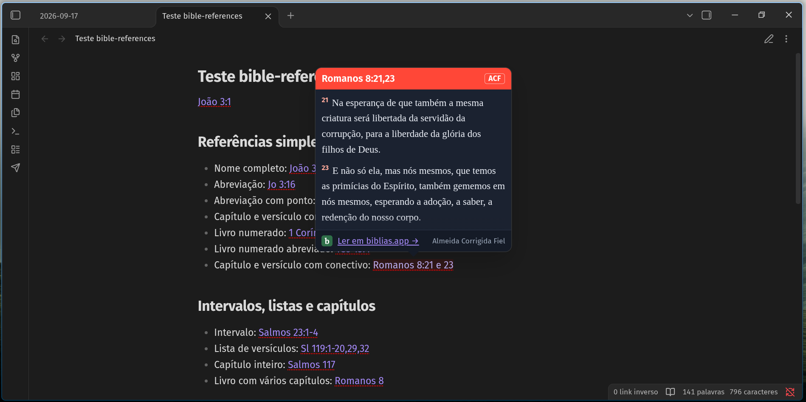

# Bible References para Obsidian

Consulte passagens bíblicas diretamente nas suas notas do Obsidian. O plugin identifica referências no modo de leitura e exibe o texto em uma janela, sem precisar sair da nota.



As passagens são consultadas no [biblias.app](https://biblias.app), na tradução Almeida Corrigida Fiel (ACF), usando a biblioteca [Bible References](https://github.com/coisasdoalto/bible-references). É necessário acesso à internet para consultar os textos.

## Instalação manual

Requer Obsidian 1.8.0 ou mais recente.

1. Baixe `bible-references.zip` na [última release](https://github.com/coisasdoalto/obsidian-bible-references/releases/latest).
2. Extraia o ZIP na pasta `.obsidian/plugins/` do seu cofre. Ele criará a pasta `bible-references` com os arquivos do plugin.
3. No Obsidian, abra **Configurações → Plugins da comunidade**, desative o modo restrito se necessário e habilite **Bible References**. Se o plugin não aparecer, recarregue o Obsidian.

## Uso e configurações

Escreva uma referência, como `João 3:16`, e abra a nota no modo de leitura. Interaja com a referência destacada para consultar a passagem.

Em **Configurações → Bible References**, você pode escolher a cor de destaque da janela, o tema (acompanhar o Obsidian, claro ou escuro) e o estilo (padrão ou compacto).

## Desenvolvimento

```sh
npm install
npm test
npm run build
```

O build gera `main.js` e `styles.css` na raiz do projeto. Para testar no Obsidian, copie esses arquivos e `manifest.json` para `.obsidian/plugins/bible-references/` no cofre e habilite o plugin.
